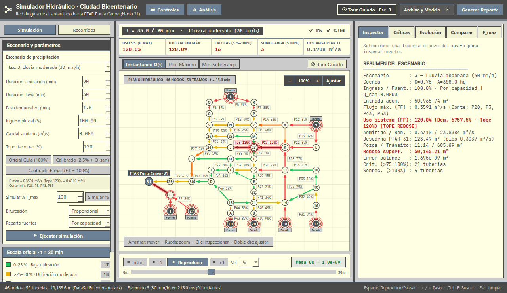

# Simulador de Red de Alcantarillado — Ciudad Bicentenario (Cartagena)

Aplicación de escritorio en Python para la representación, simulación temporal y visualización por escala de colores del flujo en la red de alcantarillado del Macroproyecto Ciudad Bicentenario hasta el punto de descarga en la PTAR de Punta Canoa (Nodo `31`).



## Características Principales

- **Estructuras de datos implementadas desde cero** (`src/data_structures/`): `DirectedGraph`, `LinkedList` (listas de adyacencia e historial temporal), `Queue`, `PriorityQueue` (Min-Heap para eventos de tránsito y ranking), `Stack` y `HashTable`.
- **Algoritmos propios** (`src/algorithms/`): `BFS`, `DFS` iterativo con reconstrucción de caminos, **Ford-Fulkerson (Edmonds-Karp)** para flujo máximo del sistema ($F_{\max} = 0.35915\;\text{m}^3/\text{s}$) y corte mínimo (`P28, P3, P43, P53`), ordenamiento topológico, búsqueda y trazado aguas arriba/abajo, y clasificación de criticidad según la escala de 5 colores de la guía (`0–25%`, `>25–50%`, `>50–75%`, `>75–100%`, `>100%`).
- **Carga dual validada** (`src/io/`): Lectura desde `data/DataSetBicentenario.xlsx` y desde archivos CSV normalizados en `data/csv/`.
- **Motor temporal conservativo de masa** (`src/simulation/`): Método racional ($Q = 0.00278 \cdot C \cdot I \cdot A$), velocidades de Manning, tiempos de tránsito $t_i = L_i / V_i$, admisión acotada por $F_{\max}$ con tope físico por rebose configurable (`120%` por defecto, donde no ingresa más agua y el porcentaje deja de crecer), simulador/estimador por `% de F_max` y almacenamiento temporal en pozos.
- **Interfaz gráfica interactiva** (`src/gui/`): Lienzo con zoom/paneo y tooltips, reproductor temporal (iniciar, pausar, reanudar, paso a paso y barra de tiempo), tabla de tuberías críticas, gráficas Matplotlib, comparación entre los 5 escenarios y pestaña **Flujo Máx. (FF)**.

## Requisitos

- Python 3.11+
- `PySide6`, `openpyxl`, `matplotlib`, `python-docx`, `lxml`, `Pillow` (instalables con `pip install -r requirements.txt`)

*(Nota: la exportación a Word `.docx` con ecuaciones OMML nativas funciona 100 % en Python puro sin requerir Pandoc instalado en el equipo de sustentación).*

## Preparación rápida (un comando)

En Windows, crea el entorno virtual `.venv`, instala las dependencias de `requirements.txt` y valida el ambiente ejecutando:
```bat
setup.bat
```
Opciones útiles:
- `setup.bat --run`: Prepara el ambiente e inicia la interfaz gráfica inmediatamente.
- `setup.bat --test`: Prepara el ambiente y ejecuta la suite de pruebas unitarias.

Una vez preparado, también puedes ejecutar el programa con:
```bat
.venv\Scripts\python.exe main.py
```

## Ejecución

### Interfaz Gráfica (GUI)
```bash
python main.py
```

### Generación de Reportes y Documento Técnico (CLI)
```bash
python main.py --report-docx docs/REPORTE_ESCENARIOS.docx
python main.py --technical-docx docs/DOCUMENTO_TECNICO.docx
python main.py --report docs/REPORTE_ESCENARIOS.md
```

### Figuras Matplotlib a una columna (`3.5 × 2.8 in`)
```bash
python -m src.simulation.charts_export
```

### Pruebas Unitarias y Capturas de Documentación
```bash
python -m unittest discover -s tests -v
python scripts/capture_doc_screenshots.py
```

## Estructura del Proyecto

- `main.py`: Punto de entrada (GUI y modos CLI `--report`, `--report-docx`, `--technical-docx`).
- `setup.bat`: Script de Windows para crear `.venv`, instalar dependencias y ejecutar/probar en un comando.
- `requirements.txt`: Dependencias portables para ejecución en otro equipo.
- `data/`: Dataset oficial `DataSetBicentenario.xlsx` y su versión en `csv/`.
- `src/data_structures/`: Estructuras de datos obligatorias propias.
- `src/algorithms/`: BFS, DFS, consultas y análisis de criticidad.
- `src/io/`: Cargadores y validadores Excel/CSV.
- `src/simulation/`: Motor de simulación, comparación, figuras `3.5 × 2.8 in` y exportador Word `.docx` (OMML `8.5 pt`) sin Pandoc.
- `src/gui/`: Interfaz gráfica modular en **PySide6 + Matplotlib** en 4 capas (Estado `state.py`, Diseño `theme.py`/`icons.py`/`widgets.py`, Subsistema Cartográfico `canvas/`, Paneles `panels/` y Orquestador `app.py`) con sistema visual **Lámina Cartográfica de Archivo Hidráulico** (Grafito `#4A4A4A`, Plata `#CBCBCB`, Marfil `#FFFFE3` y Azul Pizarra `#6D8196`).
- `docs/`: Documento técnico en Word (`DOCUMENTO_TECNICO.docx`), Markdown y reportes de escenarios.
- `scripts/`: Generador reproducible de capturas de pantalla para la documentación.
- `assets/`: Fuentes tipográficas (`Inter`) utilizadas por la interfaz.
- `tests/`: Suite de pruebas unitarias.
