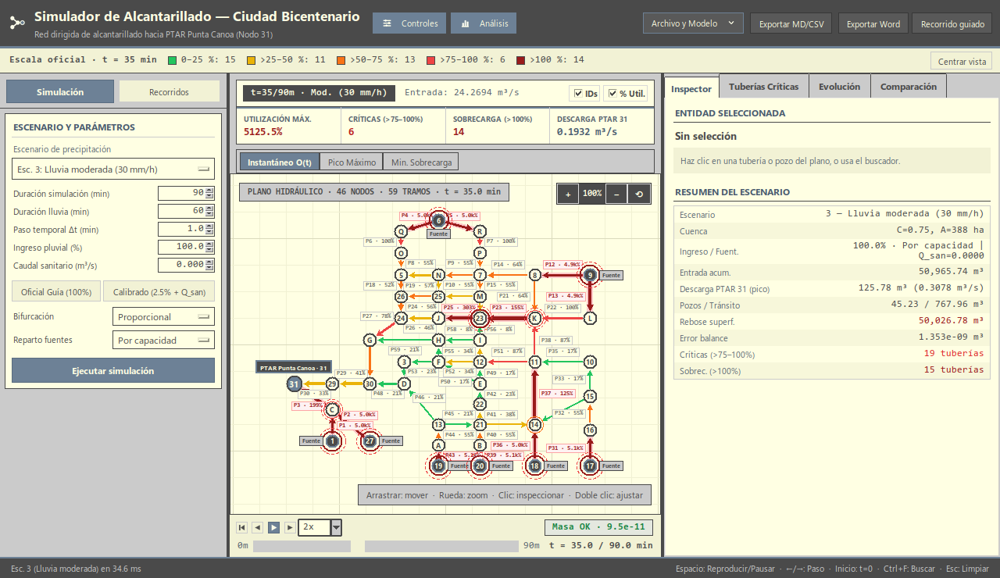

# Documento Técnico — Simulación y Visualización del Flujo en la Red de Alcantarillado de Ciudad Bicentenario

**Asignatura:** Estructuras de Datos  
**Caso de estudio:** Macroproyecto Ciudad Bicentenario, Cartagena de Indias (Descarga final: PTAR Punta Canoa, Nodo `31`)  
**Lenguaje y GUI:** Python 3.11 + Tkinter + Matplotlib  

---

## 1. Introducción

El presente documento describe el diseño, las estructuras de datos, los algoritmos y el modelo de simulación temporal desarrollados para analizar el comportamiento hidráulico simplificado de la red de alcantarillado de Ciudad Bicentenario ante cinco escenarios de precipitación (`Dry weather`, `Light rain`, `Moderate rain`, `Heavy rain`, `Extreme rain`).

La red suministrada en `DataSetBicentenario.xlsx` (y exportada a `data/csv/`) está conformada por **46 vértices** (8 alcantarillas fuente, 37 pozos de inspección intermedios y 1 sumidero terminal en la PTAR de Punta Canoa, nodo `31`) conectados mediante **59 tuberías dirigidas** (`P1` a `P59`) que suman una longitud total de **19,163.57 m** (19.16 km).

---

## 2. Arquitectura del Software

El proyecto sigue una arquitectura modular desacoplada por responsabilidades:

- `src/data_structures/`: Implementaciones propias (desde cero) de las seis estructuras de datos obligatorias (`HashTable`, `LinkedList`, `Queue`, `PriorityQueue`, `Stack`, `DirectedGraph`).
- `src/algorithms/`: Algoritmos de recorrido (`bfs`, `dfs`, `topological_sort`), búsqueda y trazado (`find_node`, `find_pipe`, `search_entities`, `trace_downstream`, `trace_upstream`), y clasificación/ranking de criticidad (`classify_utilization`, `rank_critical_pipes`).
- `src/io/`: Carga y validación estricta de datos desde Excel (`.xlsx`) y carpetas CSV (`data_loader.py`).
- `src/simulation/`: Motor discreto-temporal conservativo de masa (`engine.py`), comparador multiescenario (`comparison.py`), figuras a una columna (`charts_export.py`) y generadores de reportes Markdown/CSV (`reporter.py`) y Word `.docx` con ecuaciones OMML (`docx_exporter.py`).
- `src/gui/`: Aplicación de escritorio Tkinter modular con lienzo interactivo del grafo (`network_canvas.py`), gráficas Matplotlib embebidas (`charts_panel.py`), recorrido guiado (`guided_tour.py`), paneles dedicados (`controls_panel.py`, `inspector_panel.py`, `comparison_panel.py`, `widgets.py`, `theme.py`, `icons.py`) y orquestación principal (`app.py`).
- `tests/`: Suite de 41 pruebas unitarias automatizadas con `unittest`.

---

## 3. Estructuras de Datos Implementadas

Todas las estructuras centrales fueron implementadas sin delegar lógica de grafos ni colecciones avanzadas a librerías externas:

| Estructura | Archivo | Implementación | Aplicación en el Proyecto | Complejidad |
|---|---|---|---|---|
| **Grafo Dirigido** | `src/data_structures/graph.py` | Vértices (`ManholeNode`) y aristas (`PipeEdge`) con adyacencia directa e inversa | Modelado topológico e hidráulico de alcantarillas, pozos y tuberías | $O(V + E)$ espacio |
| **Lista de Adyacencia** | `src/data_structures/linked_list.py` | Lista doblemente enlazada usada por cada nodo en `_adj` y `_radj` | Almacenamiento de tuberías salientes y entrantes por vértice | $O(1)$ inserción |
| **Cola (FIFO)** | `src/data_structures/queue.py` | Cola respaldada por `LinkedList` propia | Recorrido BFS, trazado aguas arriba/abajo y ordenamiento topológico | $O(1)$ enqueue/dequeue |
| **Cola de Prioridad** | `src/data_structures/priority_queue.py` | Min-Heap binario propio con desempate determinista | Programación de llegadas por tiempo de tránsito $t_i$ y ranking de tuberías críticas | $O(\log n)$ push/pop |
| **Pila (LIFO)** | `src/data_structures/stack.py` | Pila respaldada por `LinkedList` propia | Recorrido DFS iterativo y reconstrucción de caminos hacia el nodo `31` | $O(1)$ push/pop |
| **Tabla Hash** | `src/data_structures/hash_table.py` | Encadenamiento separado con rehash dinámico ($\alpha > 0.75$) | Consulta instantánea de nodos/tuberías por ID y registro de visitados/estado | $O(1)$ promedio |
| **Lista Enlazada** | `src/data_structures/linked_list.py` | Lista doblemente enlazada | Historial completo de instantáneas `TimeStepSnapshot` para consulta temporal | $O(1)$ append, iteración bidireccional |

---

## 4. Algoritmos Implementados

1. **BFS (`src/algorithms/traversals.py`)**: Explora la red por niveles de saltos desde un nodo origen usando `Queue` y `HashTable`. Reconstruye el camino más corto en saltos mediante `Stack`.
2. **DFS (`src/algorithms/traversals.py`)**: Explora en profundidad de forma iterativa usando `Stack`, evitando desbordamientos de pila y reconstruyendo rutas dirigidas hasta la PTAR `31`.
3. **Ordenamiento Topológico de Kahn (`src/algorithms/traversals.py`)**: Verifica que la red es un Grafo Acíclico Dirigido (DAG: 46/46 nodos ordenados sin ciclos) y define el orden determinista de propagación por paso de tiempo.
4. **Búsqueda y Trazado (`src/algorithms/queries.py`)**: Consultas exactas $O(1)$ por identificador y filtrado por subcadenas, además de trazado completo de subredes aportantes aguas arriba y rutas de descarga aguas abajo.
5. **Clasificación y Ranking (`src/algorithms/analysis.py`)**: Implementa la escala oficial de cinco colores de la Sección 7 y ordena las tuberías mediante `PriorityQueue` propia.

---

## 5. Modelo de Simulación Temporal y Supuestos

### 5.1 Estimación de Caudal de Entrada (Método Racional)
Para una cuenca con coeficiente de escorrentía $C = 0.75$ y área $A = 388\text{ ha}$:

$$Q_{\text{racional}}(t) = 0.00278 \cdot C \cdot I(t) \cdot A$$

Dado que la red modelada corresponde a conducción sanitaria (`Ø 8"` a `Ø 20"`, capacidades $Q_{\max}$ entre `0.02965` y `0.34140 m³/s`), el modelo incorpora:
- Un **factor de ingreso pluvial configurable** ($f_{\text{ing}}$, valor oficial por defecto **`100.0%`** según guía, con preset directo a `2.5%` para análisis de sensibilidad por infiltración y conexiones erradas).
- Un **caudal sanitario base en tiempo seco** configurable (`0.0000 m³/s` por fuente por defecto, calibrable en GUI para evaluar flujo base en el Escenario 1).

El caudal pluvial se distribuye entre los 8 nodos fuente (`1, 6, 9, 17, 18, 19, 20, 27`) mediante selector configurable: **ponderado por capacidad instalada de salida** (predeterminado, evitando castigar artificialmente cabeceras de 8") o **reparto uniforme `1/8`** (comparable con la distribución homogénea).

### 5.2 Tiempos de Tránsito y Cola de Prioridad
Cada tubería $i$ utiliza la capacidad precalculada $Q_{\max,i}$ (Manning) para obtener su velocidad de referencia a tubo lleno:

$$V_i = \frac{Q_{\max,i}}{\pi D_i^2 / 4}, \qquad t_i = \frac{L_i}{V_i}$$

En la red de Ciudad Bicentenario, $V_i \in [0.914, 1.684]\text{ m/s}$ y $t_i \in [0.81, 18.05]\text{ min}$. Cuando un volumen entra a una tubería cuyo tiempo de tránsito supera $\Delta t$, se agenda en la `PriorityQueue` global con clave `t_llegada`, evitando el desplazamiento instantáneo del agua.

### 5.3 Utilización Física Acotada, Demanda y Rebose Superficial
- En pozos con múltiples salidas, el caudal se reparte de forma **proporcional a $Q_{\max}$** (o uniforme como opción comparable).
- Se distingue entre **utilización física acotada** $O_i(t) \in [0, 115\%]$ (donde la sobrepresión por columna de agua en el pozo satura asintóticamente a $115\%$ y el caudal conducido aguas abajo se acota a $Q_{\max,i}$) y el **índice de demanda** $D_i(t) = Q_{\text{demanda},i}(t) / Q_{\max,i}$ ($\times Q_{\max}$) junto al déficit en $\text{m}^3/\text{s}$.
- Cada pozo posee una capacidad física amortiguadora finita ($V_{\text{pozo,max}} = 4.0\text{ m}^3$ por defecto); al superarse, el excedente se deriva a **rebose superficial en vía** (`surface_flooding_m3`), cerrando la conservación exacta de masa en cada instante $t$:

$$V_{\text{inyectado}}(t) = V_{\text{PTAR}}(t) + V_{\text{pozos}}(t) + V_{\text{tránsito}}(t) + V_{\text{rebose}}(t)$$

---

## 6. Resultados de Simulación y Comparación de Escenarios

Con los parámetros oficiales por defecto (simulación `90 min`, lluvia uniforme `60 min`, $\Delta t = 1\text{ min}$, $f_{\text{ing}} = 100\%$, reparto por capacidad instalada en fuentes, $Q_{\text{san}} = 0.0\text{ m}^3/\text{s}$), el reporte completo por escenario y por tubería se genera automáticamente en [`REPORTE_ESCENARIOS.md`](REPORTE_ESCENARIOS.md), [`REPORTE_ESCENARIOS.docx`](REPORTE_ESCENARIOS.docx), `REPORTE_ESCENARIOS_tuberias.csv` y el entregable maestro a dos columnas [`DOCUMENTO_TECNICO.docx`](DOCUMENTO_TECNICO.docx).

### 6.1 Evidencia Visual de Capacidades Avanzadas (`docs/screenshots/`)

- **Vista general:** 
- **Motor hidráulico (sub-pasos, rebose `4.0 m³`, intervenciones `Antes vs. Después`, reglas):** `01_1_subpasos_transit.png`, `01_2_almacenamiento_rebose.png`, `01_3a_intervencion_mapa.png`, `01_3b_antes_despues.png`, `01_4_reglas_gui.png`.
- **Algoritmos (BFS `Queue`, DFS `Stack`, `Aislar cuenca`, nodos desconectados, fuentes `F1..F27`, persistencia):** `02_1a_bfs_queue.png`, `02_1b_dfs_stack.png`, `02_2_aguas_arriba_aislar.png`, `02_3_nodos_desconectados.png`, `02_4_composicion_fuentes.png`, `02_5_persistencia_sobrecarga.png`.
- **GUI cartográfica (3 modos, zoom + anillos rebose, `twinx()` + perfil longitudinal, Recorrido Guiado, comparación y modo compacto):** `03_1a_modo_instantaneo.png`, `03_1b_modo_pico.png`, `03_1c_modo_sobrecarga.png`, `03_2_canvas_zoom_rebose.png`, `03_3a_hidrograma_twinx.png`, `03_3b_perfil_longitudinal.png`, `03_4_recorrido_guiado.png`, `03_5a_comparacion_escenarios.png`, `03_5b_ui_compacta.png`.
- **CLI, exportación CSV y 41 pruebas unitarias:** `04_1_carga_export_csv.png`, `04_2_cli_reportes.png`, `04_3_tests_41.png`.

---

## 7. Validación y Pruebas

La suite automatizada (`python -m unittest discover -s tests -v`) verifica de extremo a extremo:
1. Operaciones, colisiones, redimensionamiento y ordenamiento de `HashTable`, `LinkedList`, `Queue`, `PriorityQueue`, `Stack` y `DirectedGraph`.
2. Recorridos `BFS` y `DFS` alcanzando la PTAR (`31`) desde los 8 nodos fuente, reconstrucción de caminos con `Stack`, y validación topológica DAG (`46/46`).
3. Paridad exacta entre carga desde `DataSetBicentenario.xlsx` y `data/csv/` (`46` nodos, `59` tuberías, `19,163.57 m`), más rechazo controlado de archivos inválidos.
4. Retardo físico por tiempo de tránsito (en $t = 1\text{ min}$ la descarga en `P30` y nodo `31` es `0.0 m³/s`).
5. Separación entre utilización física acotada ($\le 115\%$) e índice de demanda, pozos finitos con rebose superficial, conservación de masa (error $< 10^{-6}\text{ m}^3$) y comportamiento interactivo completo de la GUI.

---

## 8. Conclusiones y Limitaciones

- La representación mediante grafo dirigido propio permite integrar recorridos clásicos (BFS/DFS) con un motor temporal discreto eficiente (< 90 ms por simulación de 90 pasos).
- Los tramos iniciales de diámetro `8"` (`P31`, `P39`, `P43`, `P4`, `P5`) y las conexiones convergentes (`P25`, `P3`) concentran los primeros cuellos de botella y el rebose superficial al incrementarse la intensidad de lluvia.
- **Limitaciones:** El modelo no resuelve las ecuaciones hidrodinámicas completas de Saint-Venant ni calcula tirantes/láminas de agua por sección; el almacenamiento finito en pozos y el rebose superficial representan una abstracción volumétrica de sistema dual para garantizar la conservación de masa y el realismo físico en un contexto académico.
